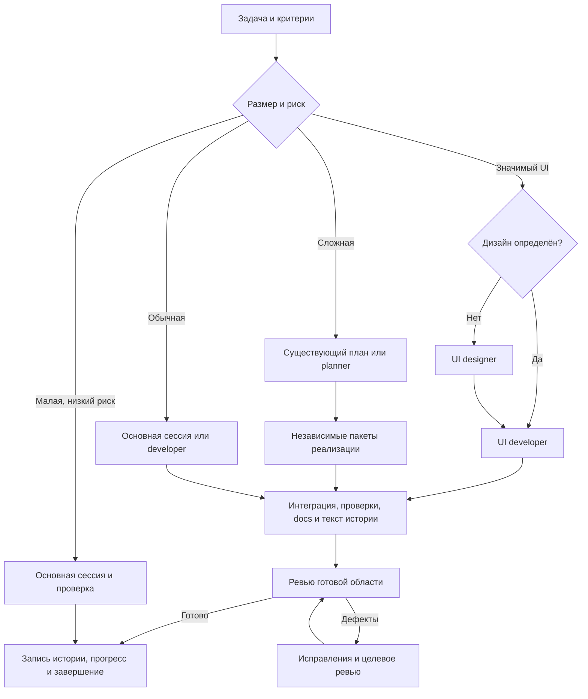

# Переносимая система агентов Codex

Переносимый комплект для разработки в Codex. Он помогает выбрать подходящий процесс
для задачи, назначить модель и effort каждой роли и проверить результат. Простые правки
выполняет основная сессия. Специалисты подключаются по задаче, а изменения поведения
проходят независимое ревью.

В комплекте восемь ролей, пять навыков, правила для клиент-серверной разработки,
TDD, Git и UI, а также отдельные записи изменений для сборки журнала выпуска.

- [Короткая инструкция по переносу и первой проверке](docs/quick-start.md)
- [Формат планов, статусы и проверка прогресса](codex-kit/.agents/skills/dev-plan/references/lifecycle.md)
- [Разбор эффективности и принятые решения](docs/efficiency-review.md)
- [Итоговый аудит согласованности и объёма](docs/kit-audit.md)
- [Повторный аудит TDD, Git и UI](docs/pipeline-audit-2026-11-15.md)
- [Пересмотр правил и дополнения для клиент-серверных систем](docs/rules-review.md)
- [Требования к производительности](docs/performance-policy.md)
- [TDD: применение и ограничения](docs/tdd.md)
- [UI-специализации и принципы UX](docs/ui-workflow.md)
- [История изменений: обоснование и применение](docs/change-history.md)
- [Модели, effort и правила повышения сложности](docs/models.md)
- [Проверки и сценарии оценки](docs/validation.md)
- [Шаблон контекста проекта](codex-kit/.codex/project.md)

## Установка копированием

Следуй [короткой инструкции](docs/quick-start.md): что копировать, как объединить
существующие настройки, заполнить контекст и проверить запуск одной роли.
В целевой проект переносится содержимое `codex-kit/`, включая скрытые папки.

После установки доступны команды:

```text
$dev-cycle Исправь ... Критерии готовности: ...
$dev-cycle Выполни .plans/feature.md
$dev-plan Спланируй ...
$dev-plan Сохрани согласованный выше план
$dev-review Проверь незакоммиченные изменения в ...
$dev-docs Обнови инструкцию по ...
$git-workflow Подготовь коммит только для ...
```

Навыки допускают обычный автоматический выбор по описанию. Простая правка
выполняется напрямую, даже при вызове `dev-cycle`. Ревью изменений поведения
и особенно рискованных областей сохраняется независимо от длины diff.

## Как работает



`explorer` подключается для узкого неизвестного вопроса, `expert` — для сложного
риска или повторного неуспеха. В комплекте восемь ролей; запускать все одновременно не нужно.
Исправления продолжаются в том же агенте; самостоятельное ревью его работы — в другом.

Модель и effort каждой роли находятся в одном TOML. Если инструмент поддерживает
зарегистрированные роли, используется имя роли; для интерфейса `collaboration`
настройки и инструкции передаются явно с `fork_turns: "none"`.
Это описано в [адаптере запуска](codex-kit/.agents/skills/dev-cycle/references/runtime.md).
Наличие TOML само по себе не доказывает применение профиля в текущем чате.

При отдельном ревью чужого diff основная сессия может проверить его сама;
делегирование нужно для независимости от автора или полезного второго взгляда.
В цикле реализации изменение поведения/высокий риск сохраняет независимое ревью.

Git-операции выполняет текущая сессия по [git-workflow](codex-kit/.agents/skills/git-workflow/SKILL.md).
Он содержит baseline, передачу владения, worktree, интеграцию и оформление; `dev-cycle`
ссылается на него. Это один из пяти навыков, отдельной Git-роли нет. Владелец Git-состояния
один на worktree; общие refs и операции репозитория также координируются.
Для обычного baseline читается короткий входной файл; операционные шаги открываются
только перед соответствующим Git-действием. Подтверждённые проверки повторяются по изменению/риску.

## Правила разработки

`AGENTS.md` направляет агента читать только нужные файлы `.codex/rules/`:
инженерная база, производительность, контракты, распределённое выполнение, данные,
безопасность, эксплуатация, клиент, UX/UI и история. Каталог не является отдельным механизмом автозагрузки.
При переносе копируй его вместе с остальным комплектом; список применимых тем
выбирается на каждую задачу. Подробное обоснование и проверка исходных правил —
в [разборе правил](docs/rules-review.md).

Для воспроизводимых багов и автоматически проверяемого поведения применяется TDD
по [инженерным правилам](codex-kit/.codex/rules/engineering.md): Red → Green → Refactor.
Цикл выполняет автор реализации, reviewer проверяет готовый результат. Условия
применения и исключения описаны в [обосновании](docs/tdd.md); новые роли не добавлены.

## История изменений

Каждый завершённый результат записывается отдельно в `.changes/entries/`, включая
изменения без плана. Уникальное имя создаёт скрипт; общий changelog не редактируется
на feature-ветках. Тексты для пользователя и поддержки хранятся в одной записи,
а сборка формирует отдельные Markdown-отчёты и manifest.

```powershell
python .codex/scripts/changes.py new --kind fixed --component "Заказы" --user "Исправлено сохранение заказа при повторном нажатии." --support "Условия, решение и выполненные проверки."
python .codex/scripts/changes.py check
```

Состав выпуска выбирается между Git-ревизиями; label и дата передаются сборкой.
Нумерация версий не задаётся. [Полный формат и команды](codex-kit/.changes/README.md).
Готовый пример: [для пользователей](examples/history-preview/CHANGELOG.md) и
[для поддержки](examples/history-preview/SUPPORT-CHANGELOG.md). Это черновой вывод
на реальной записи о доработке комплекта, не опубликованный выпуск.

## Переход с прежней системы DMC

Новые команды заменяют `execute-development-cycle`/`execute-plan`,
`plan-development`/`save-plan`, `review-code-review`, `doc-tech-writer`/`doc-user-doc-writer`.
Старые планы можно выполнять без переформатирования. Старые навыки в этом комплекте
не дублируются: при установке убери их конфликтующие маршруты из активных инструкций
или оставь старые навыки только для явного вызова. Автоматическое удаление не производится.
Прочие проектные интеграции и навыки, например работа с эскалациями, остаются отдельно.
